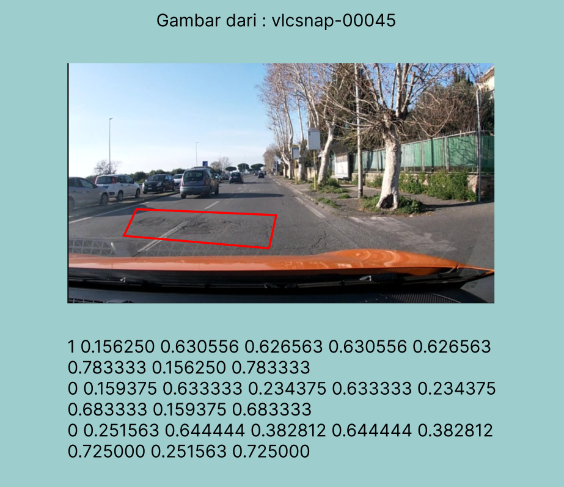

# Crashless Mobile

Aplikasi Flutter untuk mendeteksi kerusakan jalan menggunakan model YOLOv8 TFLite dan menyimpan laporan ke Supabase.



## Fitur

- Deteksi `pothole`, `crack`, dan `manhole` dari kamera atau galeri.
- Bounding box dan confidence hasil deteksi.
- Pengambilan lokasi GPS dan alamat.
- Penyimpanan gambar serta riwayat laporan ke Supabase.
- Refresh riwayat dengan swipe dari atas ke bawah.
- Gambar tanpa deteksi kerusakan tidak dapat dikirim.

## Teknologi

- Flutter dan Dart
- TensorFlow Lite melalui `tflite_flutter`
- Supabase Database dan Storage
- Geolocator dan Geocoding

## Persiapan

- Flutter SDK 3.x atau lebih baru
- Dart SDK 3.x atau lebih baru
- Android SDK API 24 atau lebih baru
- JDK 17
- Project Supabase

## Konfigurasi

Buat file `assets/.env`:

```env
supabase_url=https://example.supabase.co
supabase_key=SUPABASE_PUBLISHABLE_KEY
```

Jangan commit file `.env` ke repository.

Pastikan model tersedia di:

```text
assets/models/crashless_model.tflite
```

## Menjalankan Aplikasi

```bash
flutter pub get
flutter run
```

Untuk menjalankan pada mode release:

```bash
flutter run --release
```

## Build APK

```bash
flutter build apk --release
```

APK berada di:

```text
build/app/outputs/flutter-apk/app-release.apk
```

## Pengujian

```bash
flutter test
```

## Struktur Utama

```text
lib/
├── config/      # Konfigurasi aplikasi
├── models/      # Model data dan deteksi
├── services/    # ML, Supabase, autentikasi, lokasi
├── screens/     # Login, deteksi, riwayat, detail
└── widgets/     # Widget dan bounding box
```
